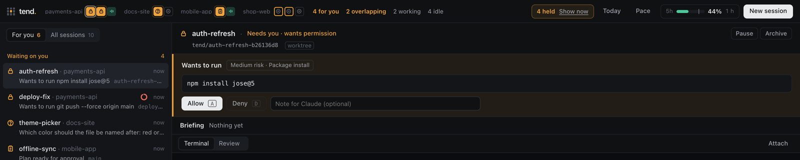
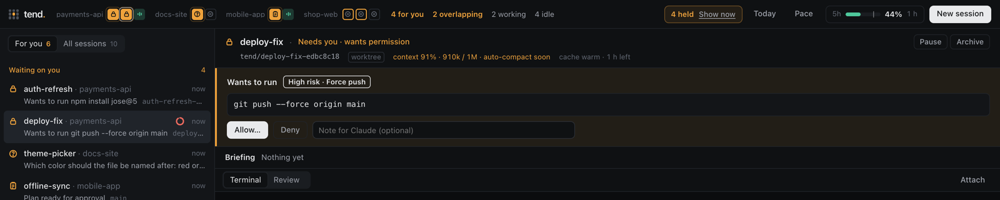
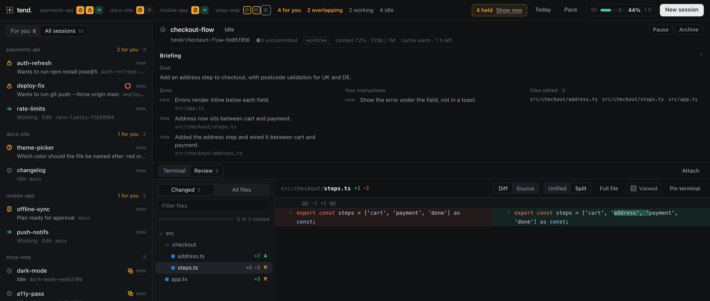
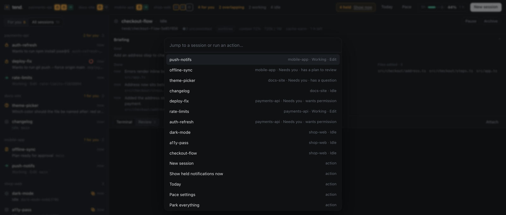
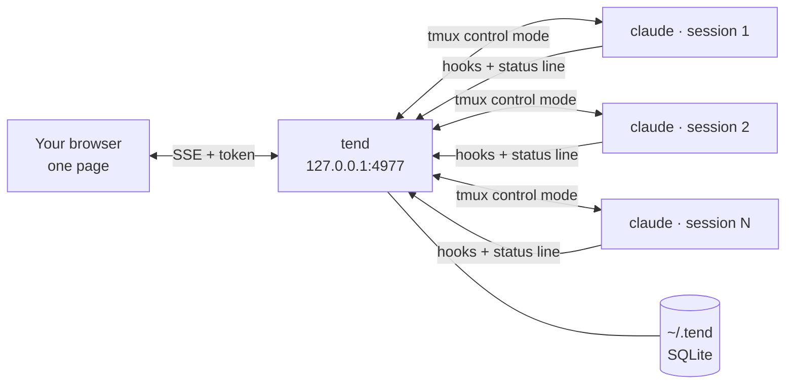

<div align="center">

<picture>
  <source media="(prefers-color-scheme: dark)" srcset="https://raw.githubusercontent.com/Geekgineer/tend/main/docs/assets/logo-dark.svg">
  
</picture>

### One calm page for every Claude Code session.

Run 5 or 25 Claude Code sessions and see them all in one place: what each one is doing, which ones need you,<br>
what they changed and what they cost. Only the things that need you interrupt you.

<p>
  <a href="https://www.npmjs.com/package/tend-cc"></a>
  
  
  
  
  
  
  
</p>

<a href="https://github.com/Geekgineer/tend/blob/main/docs/assets/tend-launch.mp4"></a>

<sub>▶ <a href="https://github.com/Geekgineer/tend/blob/main/docs/assets/tend-launch.mp4">Watch the launch video with sound</a></sub>

</div>

<br>

## Why tend

Running a handful of Claude Code sessions at once means a wall of terminals. One of them is waiting on a permission
prompt. Another finished ten minutes ago. Two are editing the same file. You find out by tabbing through every window.

**tend turns that wall into one page.** It doesn't wrap or replace Claude Code: every session is the real Claude Code
TUI running in tmux. tend listens to Claude Code's own hooks and status line, and puts what matters on top.

<table>
<tr>
<td width="50%" valign="top">

### 🟧 Only what needs you
**For you** lists the sessions waiting on a permission, a question or a plan, then problems (stuck, crashed,
overlapping). Everything else stays quiet.

</td>
<td width="50%" valign="top">

### 🃏 Answer from a card
Permission, question and plan cards go through Claude Code's own hook. Allow, deny or add a note without opening
the terminal. Answer in the terminal instead and the first answer wins.

</td>
</tr>
<tr>
<td valign="top">

### 🛡️ Risk labels that mean it
Rule-based risk labels on every request. **High-risk requests are never one click and never "always allowed".**

</td>
<td valign="top">

### 🔍 Review it like a PR
A **Terminal | Review** tab per session: file tree, unified or split diffs with word-level marks, rendered
Markdown, line comments sent back to Claude as one review.

</td>
</tr>
<tr>
<td valign="top">

### 🌳 Git, safely
A worktree per session, live git facts, overlap warnings when two sessions touch the same file, Pause/Resume
that saves the work as one commit and restores it exactly.

</td>
<td valign="top">

### 📊 Usage at a glance
Context per session and 5-hour / weekly usage per account, with a pace, read from Claude Code's own status line.
Multiple accounts supported.

</td>
</tr>
</table>

<br>

## A closer look

<table>
<tr>
<td width="50%"><br><sub><b>Decision cards.</b> Medium risk is one click (or <kbd>A</kbd>).</sub></td>
<td width="50%"><br><sub><b>High risk.</b> A force push asks you to confirm, every time.</sub></td>
</tr>
<tr>
<td><br><sub><b>Review.</b> Changed files, split diff, “Viewed” marks that reset when Claude edits again.</sub></td>
<td><br><sub><b>⌘K.</b> Jump to any session or run any action.</sub></td>
</tr>
</table>

<details>
<summary><b>Everything else it does</b></summary>
<br>

- **Briefing per session.** Goal, what got done, your instructions and files, built from its events. No AI tokens spent.
- **Calm by default.** Focus windows batch everything except urgent items. Quiet hours, an hourly budget, Park
  everything, a daily wrap-up and "since you left".
- **Stuck and crashed sessions** are flagged on their own.
- **Elsewhere.** Claude sessions you started outside tend (another terminal, background agents) are listed
  read-only. Close one there with `/exit` and **Adopt** resumes the same conversation under tend, with cards,
  briefing and review. tend never stops, signals or types into a session it didn't start.
- **Media.** Paste or drop screenshots, images, PDFs and files. They become paths at the prompt.
- **Polish.** Smart links, one tend per machine, `tend rotate-token`, and a self-test after Claude Code updates.

</details>

<br>

## Quick start

```bash
npx tend-cc
```

That's it. tend starts and opens in your browser. Click **New session**, pick a folder, and you're running Claude Code from one page.

To keep it around as a `tend` command:

```bash
npm i -g tend-cc
tend
```

**Needs** macOS (the core works on Linux, untested), Node.js 24+, [tmux](https://github.com/tmux/tmux) and [Claude Code](https://docs.anthropic.com/en/docs/claude-code) logged in. Missing something? `tend doctor` tells you exactly what and how to fix it:

```text
$ npx tend-cc doctor
✓ Node.js 24+  v24.4.0
✗ tmux         → brew install tmux
✓ Claude Code  2.1.330 (Claude Code)
✓ macOS        yes
```

Sessions live in tmux, so they keep running if tend stops. Start it again and everything comes back.

<details>
<summary>Run from source</summary>

```bash
git clone https://github.com/Geekgineer/tend.git && cd tend
npm install
node bin/tend.mjs
```
</details>

| Command | What it does |
|---|---|
| `tend` | Start and open the page. One per machine; a second one tells you where the first is running. |
| `tend --no-open` | Start without opening the browser (also `TEND_NO_OPEN=1`) |
| `tend doctor` | Check Node, tmux and Claude Code, with the fix for anything missing |
| `tend rotate-token` | A new link. Old links and open tabs stop working within a second. |
| `TEND_PORT`, `TEND_HOME` | Port (default 4977) and data folder (default `~/.tend`) |

<br>

## How it works



- Every session is the **real Claude Code TUI** in tmux, streamed to xterm.js in the browser.
- tend writes a per-session settings file, so Claude Code reports to it through **its own hooks** (permissions,
  questions, plans, tool use) and **its own status line** (context, usage).
- State lives in `~/.tend` (SQLite). Node.js only: no native modules and five runtime dependencies.

<br>

## Safety and privacy

|  |  |
|---|---|
| 🔒 **Local only** | Binds to `127.0.0.1`. Every request needs the token (cookie or header), with Origin and Host checks. Only `/health` is open, and it carries no data. |
| ✋ **You approve, always** | tend never approves anything you didn't, never passes `--dangerously-skip-permissions`, and never accepts Claude's trust dialog for you. |
| 🙈 **Hands off your secrets** | tend never reads your Claude credentials and makes no network calls of its own. |
| 📭 **No telemetry** | None. Everything lives in `~/.tend`. |

<br>

## Keyboard

| Keys | Action |
|---|---|
| <kbd>⌘</kbd> <kbd>K</kbd> | Palette: jump to a session or run an action |
| <kbd>A</kbd> / <kbd>D</kbd> | Allow / deny the focused card |
| <kbd>Ctrl</kbd> <kbd>`</kbd> | Switch Terminal ⇄ Review |
| <kbd>j</kbd> / <kbd>k</kbd> | Next / previous file in Review |
| <kbd>n</kbd> / <kbd>p</kbd> | Next / previous change |
| <kbd>v</kbd> | Mark file viewed |
| <kbd>⌘</kbd> <kbd>P</kbd> | Open any file |

<br>

## FAQ

<details>
<summary><b>Does it replace Claude Code?</b></summary>
No. Every session is Claude Code itself, unmodified, in tmux. You can attach to any session from a terminal and
keep working there.
</details>

<details>
<summary><b>Does it cost tokens?</b></summary>
No. Briefings, risk labels and summaries are built from Claude Code's events by plain rules. tend spends no AI tokens of its own.
</details>

<details>
<summary><b>Linux? Windows?</b></summary>
The core works on Linux, but the Finder folder window, notifications and image conversion don't, and Linux isn't
tested. Windows isn't supported.
</details>

<details>
<summary><b>Multiple Claude accounts?</b></summary>
Yes. tend finds your Claude config folders and shows usage per account. Pick the account when you start a session.
</details>

<br>

## Project layout

```
bin/        the tend command
src/        server: sessions, tmux, hooks, git, usage, risk, store
ui/         the page: plain ES modules, no build step
test/       unit, integration and e2e (a fake Claude, no tokens spent)
scripts/    build and lint · smoke/ real-Claude runs · probe/ browser checks · perf/ load and soak
docs/       design spec, per-version results, research, README assets
```

## Development

```bash
npm test            # the full suite: fake Claude, no tokens spent
npm run typecheck
npm run check       # file size, dependency allowlist, syntax
```

| Script | What it checks |
|---|---|
| `scripts/probe/e2e-browser.mjs` | The full journey in headless Chrome (19 checks, fake Claude) |
| `scripts/smoke/real.mjs`, `decisions.mjs`, `usage.mjs`, `media.mjs` | Real Claude (haiku), throwaway temp repos |
| `scripts/smoke/package.mjs` | Pack, install into an empty folder, run |
| `scripts/smoke/selftest.mjs` | The Claude Code compatibility self-test (one tiny prompt) |
| `scripts/perf/load.mjs`, `soak.mjs` | 20 sessions under load; long soak runs |

Design: [`docs/design/2026-10-27-tend-design.md`](docs/design/2026-10-27-tend-design.md). Per-version criteria and
results: [`docs/versions/`](docs/versions/). More in [`docs/`](docs/README.md).

<br>

## License

[MIT](LICENSE)

<br>

<div align="center">
<sub>Built for people who run more Claude Code sessions than they have monitors.</sub>
</div>
